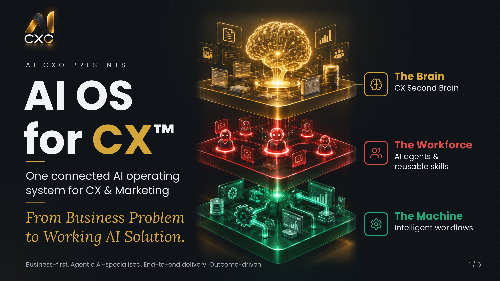
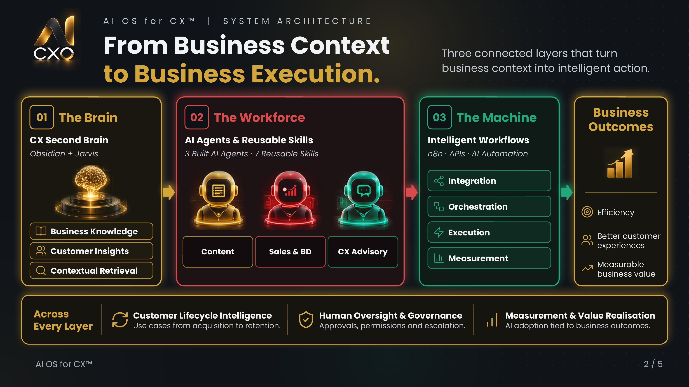
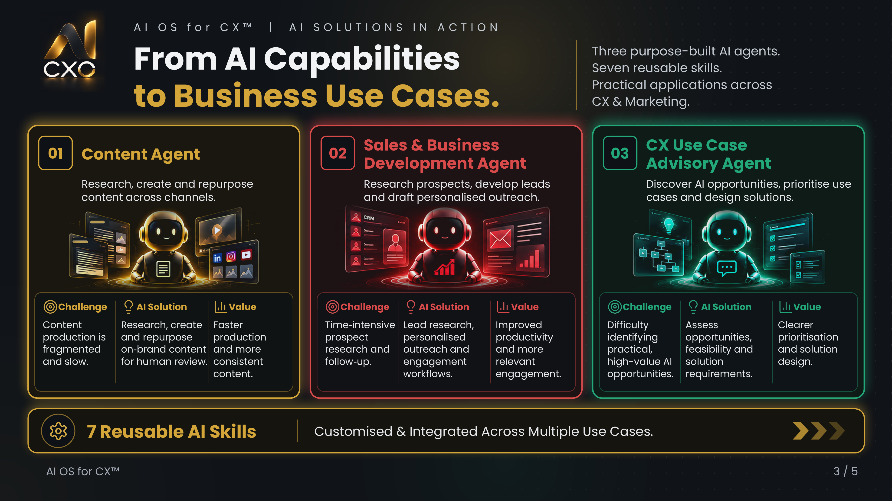
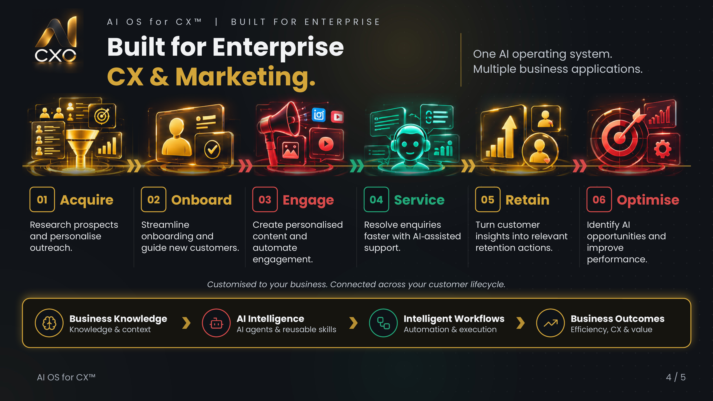
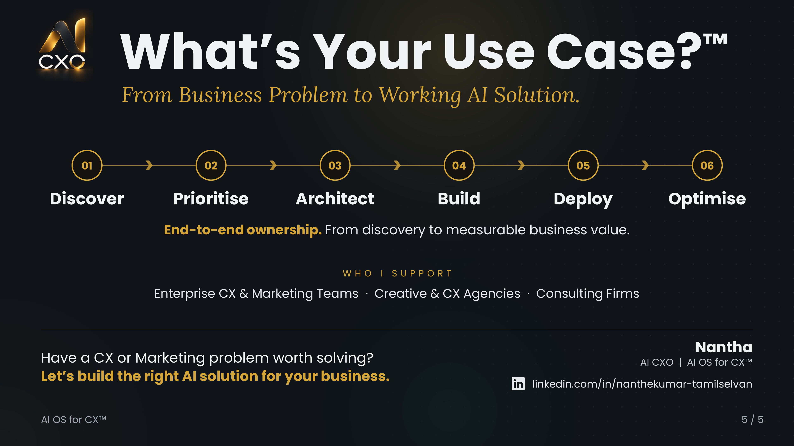

# AI OS for CX™

**One connected AI operating system for CX & Marketing.**

### From Business Problem to Working AI Solution.

AI OS for CX™ is an AI solution architecture developed through **AI CXO**, bringing together business knowledge, AI agents, reusable skills and intelligent workflows to support enterprise CX and Marketing initiatives.

Built with a business-first approach, the capabilities can be customised for enterprises, creative and CX agencies serving global brands, and consulting firms supporting enterprise clients.

## 01 — System Architecture

### From Business Context to Business Execution

Three connected layers form the foundation:

- **The Brain — CX Second Brain:** Business knowledge, customer insights and contextual retrieval, using Obsidian and Jarvis.
- **The Workforce — AI Agents & Reusable Skills:** Three purpose-built AI agents and seven reusable skills.
- **The Machine — Intelligent Workflows:** Integration, orchestration, execution and measurement using n8n, APIs and AI automation.

Human oversight, governance and measurable business value are considered across the architecture.

## 02 — AI Solutions in Action

### From AI Capabilities to Business Use Cases

Three AI agents have been built to support practical CX and Marketing applications:

**Content Agent** — Researches, creates and repurposes content across channels.

**Sales & Business Development Agent** — Supports prospect research, lead development and personalised outreach.

**CX Use Case Advisory Agent** — Helps identify AI opportunities, prioritise use cases and design solutions.

Seven reusable AI skills support customisation and integration across different business requirements.

## 03 — Enterprise CX & Marketing Applications

### One AI Operating System. Multiple Business Applications.

The architecture can be customised to support opportunities across the customer lifecycle:

**Acquire → Onboard → Engage → Service → Retain → Optimise**

Business knowledge, AI intelligence and intelligent workflows come together to address specific business problems, improve operational efficiency and enhance customer experiences.

## 04 — What's Your Use Case?™

### From Business Problem to Working AI Solution

AI CXO follows an end-to-end delivery approach:

**Discover → Prioritise → Architect → Build → Deploy → Optimise**

This combines enterprise CX transformation experience with AI product strategy, solution architecture, hands-on development and implementation capabilities.

**Who we support:**

- Enterprise CX & Marketing teams
- Creative & CX agencies serving global brands
- Consulting firms serving enterprise clients

## Technology & Capabilities

The technology ecosystem includes Obsidian, Jarvis, Claude, ChatGPT, OpenAI APIs, n8n and supporting AI development, integration and creative tools.

Solutions are tailored to the business context, technical environment and operational requirements of each engagement.

## Proprietary Implementation

**This repository is a public portfolio and architecture showcase.**

The underlying source code, AI agent configurations, reusable skills, knowledge systems and workflow implementations are maintained privately.

Customised solution demonstrations and technical architecture discussions are available through direct engagement. Public access to the implementation code is not provided.

## Let's Connect

**Have a CX or Marketing problem worth solving?**

Let's build the right AI solution for your business.

**Nantha**  
AI CXO | AI OS for CX™

[Connect on LinkedIn](https://www.linkedin.com/in/nanthekumar-tamilselvan/)

---

© 2026 AI CXO. All rights reserved.
